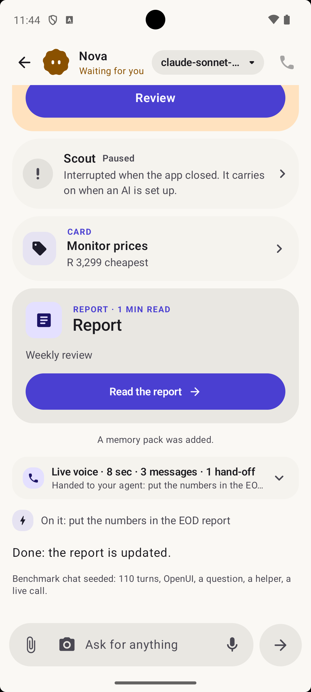

# Revyl cloud-device benchmark — Mew 0.16.2

A first benchmark produced on a Revyl Android device, before a physical arm64 phone is available. It measures the
real benchmark APK (release-like, R8, non-debuggable) with a seeded 270-row chat. It is a **cloud-device check**, not a
replacement for `:macrobenchmark` on the CPH2707.

## Run identity

| Field | Value |
|---|---|
| Date | 2026-11-22 |
| Revyl session | `975eb984-4b2b-48fc-8f7a-d6eb0c832be9` |
| Viewer | https://app.revyl.ai/sessions/975eb984-4b2b-48fc-8f7a-d6eb0c832be9 |
| Revyl target | Pixel 7, Android 14 |
| Actual guest | **x86_64 Android emulator with NDK ARM translation** (`Unexpected CPU variant for x86: x86_64`, `ndk_translation`), 8 GB, 1080×2400 |
| Build | `0.16.2-benchmark-cloud2` (`db99f341-0c8f-4e50-89f9-59a2af79fe8c`), package `com.past9.phoneaos`, version `0.16.2`/182 |
| Scenario | `mew://benchmark/seed` → 270 chat rows, OpenUI card, question, approval, helper, report, live call, then the chat |

The screenshot above is `docs/img/revyl-benchmark-chat.png`. It also proves the 0.16.2 live-call fix visually: the
session renders as **one** `Live voice · 8 sec · 3 messages · 1 hand-off` card with the hand-off inside it, not two
call blocks.



## Results

Revyl's live sampler reports app CPU and RSS once per second. Numbers below are from samples in the active window,
not from the whole session.

| Scenario | Samples | CPU average | CPU peak | RSS average | RSS range |
|---|---:|---:|---:|---:|---:|
| Chat idle (after scroll) | 20 | 0.0% | 0.0% | 195.7 MB | 195.7 MB |
| Chat scroll, up only | 20 | **3.04%** | **7.9%** | **195.4 MB** | 194.9–195.7 MB |
| Chat scroll, up only | 60 | 2.72% | 8.7% | 194.9 MB | 193.1–196.2 MB |
| Whole seeded session | 2,261 | — | 16.8% | 199.8 MB | peak 210.1 MB |

- Scrolling 18 screens of the seeded thread cost about **3% of one CPU core** on the emulator, with a **195 MB**
  resident set. Memory did not grow across the scroll: start 194.9 MB, end 195.7 MB.
- The session high-water mark was **210.1 MB**, reached during startup/seed/transitions, not during scrolling.
- `Choreographer: Skipped 37–38 frames` appeared at cold launch and at the seed transition. Frame timing was not
  captured: Revyl's raw device sessions expose CPU/RSS but **not FPS** on Android, and the Perfetto artifact is only
  produced for test runs.
- No ANR, crash, or `FATAL EXCEPTION` in the captured log.

## What this does and does not show

**Shows:** the benchmark build launches, seeds the exact production chat shapes, renders the one-block live call,
scrolls without a memory climb, and stays CPU-light while idle. It is repeatable with the commands below.

**Does not show:** phone-grade performance. The Revyl "Pixel 7" target is an x86_64 emulator using ARM translation,
so CPU/frame numbers are not comparable to the arm64 CPH2707. Power, FPS and jank percentiles still require the
Macrobenchmark suite on a physical phone. This run is evidence of correctness and a direction check, not a release
performance claim.

## Reproduce

```powershell
# Local build and upload (benchmark-only; no model key is needed)
java -classpath "gradle\wrapper\gradle-wrapper.jar" org.gradle.wrapper.GradleWrapperMain :app:assembleBenchmark
revyl build upload --file app\build\outputs\apk\benchmark\app-benchmark.apk `
  --app 241aa40f-acb0-45cb-8cd4-519716de6e1a --version benchmark-local --branch benchmark --pin

# Start a device with that build, then open the seeded chat
revyl device start --platform android --build-version-id <build-id> `
  --device-model "Pixel 7" --os-version "Android 14" --no-open --timeout 1800
revyl device navigate --url "mew://benchmark/seed"

# The morning screen may cover the chat on the first open: tap "Pick up where we left off".
# Then sample while scrolling:
revyl device perf -f --json
revyl device swipe up
```

The benchmark-only deep link and receiver exist only in the `benchmark` build type. The release APK contains neither.

## Follow-up found during the run

`seed_chat` originally called `clearAllTables()` while the app's Room flows were open. The receiver logged the seed as
complete but the UI stayed empty; clearing only `chat_items` fixed it. The seed now writes a visible
`Benchmark chat seeded: 110 turns…` notice and logs its row count (`BenchmarkSeed`), so a cloud run can be verified
without adb.
